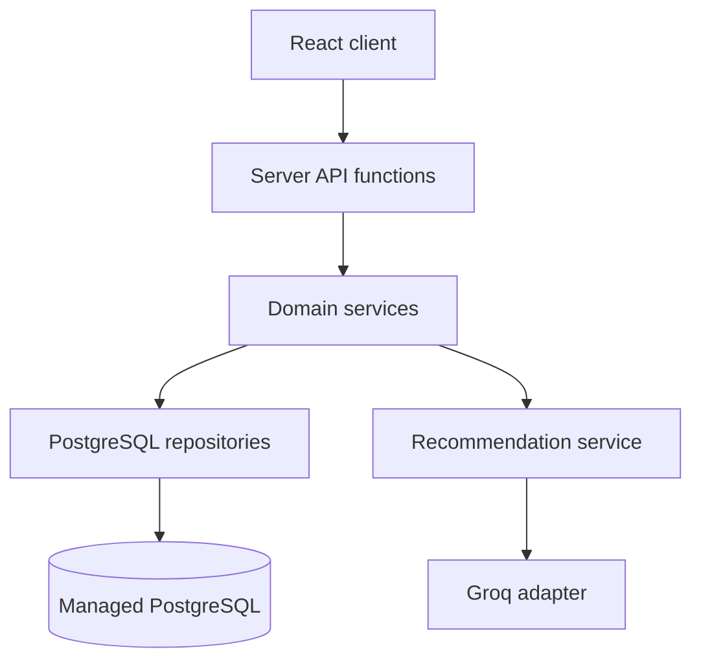
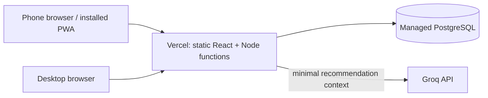

# Architecture Spine — Budget

## Design Paradigm

Layered monolith. The React client renders and collects input; server functions own validation, authorization, domain decisions, persistence, and provider calls. PostgreSQL is the durable source of truth. No client-side module may write to the database or call Groq directly.

## Invariants & Rules

### AD-1 — Server owns the budget truth [ADOPTED]

- **Binds:** All budget calculations, transactions, scenarios, and recommendations.
- **Prevents:** Client-side and server-side calculations diverging or user-controlled totals being trusted.
- **Rule:** The server validates every mutation and computes authoritative balances, scenario deltas, and priority inputs from persisted records. The client may present projections but cannot persist computed totals as source data.

### AD-2 — One vertical slice owns each mutation

- **Binds:** Budget summaries, transactions, financial items, scenarios, and recommendations.
- **Prevents:** Two services independently writing the same financial fact or applying an adjustment twice after a network retry.
- **Rule:** Transactions are the sole persisted source for actual income/expense movements; financial items are the source for planned obligations; scenarios are proposals until confirmed. A confirmed scenario creates its resulting records in one database transaction and accepts a required idempotency key. Updates use a version column or conditional update so stale clients cannot silently overwrite newer data.

### AD-3 — One PostgreSQL database is the durable source [ADOPTED]

- **Binds:** All personal financial records across phone and desktop.
- **Prevents:** Per-device copies diverging or deployment files being mistaken for durable storage.
- **Rule:** Persist application records in managed PostgreSQL accessed from server-side functions. Do not store user records in Vercel function filesystem, browser-only storage, or SQLite in the deployed app. Use migrations for schema changes.

### AD-4 — Money and time are normalized at API boundaries [ADOPTED]

- **Binds:** Income, transactions, debts, subscriptions, projects, scenarios, and API responses.
- **Prevents:** Floating-point rounding errors and month/date boundary inconsistencies.
- **Rule:** The initial profile currency is XOF (franc CFA BCEAO). Store money as integer whole XOF amounts (`amount_xof`); calculate using integer arithmetic and reject mismatched currency values rather than summing or converting them. The initial timezone is `Africa/Abidjan` (GMT/UTC+0). Store instants as UTC timestamps and calendar due dates/months as ISO date strings. Bucket transactions by local calendar date in `Africa/Abidjan`; due dates are calendar dates and are never UTC-converted.

### AD-5 — Recommendations are advisory, reviewable, and reproducible

- **Binds:** Automatic prioritization and Groq-assisted recommendations.
- **Prevents:** LLM output silently changing the budget, inventing financial facts, or giving untraceable advice.
- **Rule:** Deterministic server logic computes balances, constraints, and candidate actions. Groq may rank or explain only a bounded, server-created candidate set. Version the candidate and provider request/response schemas and prompt template; validate provider output and reject references outside the candidate IDs. Persist schema/prompt version, candidate-set hash, provider/model, minimized input snapshot, output, and timestamp. Recommendations never mutate records without explicit user confirmation.

### AD-6 — Provider secrets and financial context remain server-side

- **Binds:** Groq, database access, authentication/session handling.
- **Prevents:** Exposed API credentials and inadvertent direct browser access to private services.
- **Rule:** The only Groq-specific secret is `GROQ_API_KEY`, stored server-side. Keep the Groq API base URL fixed in the server adapter and select the model in server-side code/configuration; do not create separate `GROQ_BASE_URL` or `GROQ_MODEL` secrets. Database credentials are separate from Groq and should be injected by the managed database integration. The browser calls same-origin server endpoints; Groq receives only an allowlisted, bounded, aggregated context (budget totals, due dates, priority labels, candidate IDs/actions and user-entered deferral consequences). Do not send names, payees, notes, raw transaction histories, or direct identifiers. Never include secrets or financial payloads in logs or error responses.

### AD-7 — Single-owner private data is enforced at the server boundary [ASSUMPTION]

- **Binds:** All records and routes in the initial deployment.
- **Prevents:** Accidental public access or future multi-account assumptions being implemented inconsistently.
- **Rule:** Every financial route passes through one shared server authentication/owner-resolution function before domain logic. Derive the owner identifier exclusively from the verified server session; reject owner identifiers in request bodies/parameters. Until authentication is implemented and tested, deploy only behind restricted access and do not expose financial routes publicly.

### AD-8 — Feature code follows one dependency direction

- **Binds:** Frontend, server routes, domain services, repositories, external providers.
- **Prevents:** Circular dependencies and duplicated business rules.
- **Rule:** UI → HTTP API → domain services → repository/provider adapters. Domain services must not import React, HTTP route modules, database clients, or Groq SDKs. Repositories own SQL; provider adapters own external API calls.

### AD-9 — All endpoints share versioned contracts and errors

- **Binds:** All client/server interfaces and feature teams.
- **Prevents:** Independently implemented endpoints using incompatible field shapes, enum values, or error semantics.
- **Rule:** Define request/response schemas in one shared contract module consumed by handlers and client types; reject invalid input at the boundary. All errors use `{ error: { code, message, details? } }` with a common error-code catalog and consistent HTTP status mapping. Breaking changes require an API version change or coordinated migration.

### AD-10 — Deployments preserve environment parity and recovery

- **Binds:** Vercel Preview/Production, managed PostgreSQL, migrations, secrets, backups.
- **Prevents:** Preview/production drifting in schema or deployment settings and unrecoverable loss of private financial records.
- **Rule:** Preview and Production use separate databases/branches with the same migration sequence and compatible runtime settings. Production deployments run validated, forward-compatible migrations before code that requires them. Before production launch, enable provider backups/PITR appropriate to the selected plan, test a restore, and record a recovery owner and target. Use Vercel functions with persistent PostgreSQL; SQLite or local filesystem storage is not a production persistence option.



## Consistency Conventions

| Concern | Convention |
| --- | --- |
| API | Same-origin `/api` endpoints; JSON request/response; validate inputs and return a consistent `error.code` / `error.message` shape on failure. |
| API contracts | Shared, versioned schemas for all request and response DTOs; one shared error-code catalog and HTTP mapping. |
| IDs | UUIDs generated server-side. |
| Money | Integer whole XOF amounts for MVP; never use floating-point amounts. |
| Dates | ISO 8601 UTC instants; ISO `YYYY-MM-DD` for due dates and budget month; initial timezone `Africa/Abidjan` (GMT/UTC+0). |
| Mutations | Server-side domain service only; database transaction for multi-record changes; required idempotency key for scenario application; optimistic version check for edits; explicit user confirmation for applying a scenario. |
| Errors and logs | No secrets or raw financial payloads in logs; return actionable, non-sensitive errors; log provider failure separately from deterministic budget calculations. |
| Configuration | `GROQ_API_KEY` is the only Groq-specific secret. Database connection values are provided separately by the database integration; authentication configuration depends on the selected provider. All are server-only. |
| Database | Versioned migrations; repositories are the sole SQL boundary. |

## Stack

| Name | Version |
| --- | --- |
| React | 19.3.1 |
| Node.js | 24 LTS (Vercel supported runtime baseline) |
| Vite | 8.x (current major) |
| TypeScript | 5.x (exact release to be pinned in lockfile at scaffold time) |
| Vercel Functions | Node.js runtime (platform-managed) |
| PostgreSQL | Managed provider connected through Vercel Marketplace; Neon recommended |
| Neon serverless driver | `@neondatabase/serverless` (exact release to be pinned at scaffold time) |
| Groq API | OpenAI-compatible Responses API at `https://api.groq.com/openai/v1`; model selected in server-side code/configuration |

## Structural Seed

```text
/
  src/
    app/                  # React routes, layouts, and mobile-first screens
    features/             # Dashboard, ledger, obligations, scenarios, recommendations
    shared/               # UI primitives and client API types
    contracts/            # Canonical, versioned request/response and error schemas
  api/                    # Vercel server functions; HTTP boundary only
  server/
    domain/               # Budget, priority, scenario, and recommendation rules
    repositories/         # PostgreSQL queries and transaction boundaries
    providers/            # Groq adapter and schema validation
    auth/                 # Session verification and owner resolution
  db/
    migrations/           # Versioned PostgreSQL schema changes
  public/                 # PWA manifest, icons, and static assets
  tests/
    domain/               # Deterministic financial rules and scenario tests
    api/                  # API and persistence integration tests
```



## Capability → Architecture Map

| Capability / Area | Lives in | Governed by |
| --- | --- | --- |
| Monthly dashboard and remaining balance | `src/features/dashboard`, `server/domain/budget` | AD-1, AD-3 |
| Income and expense entry | `src/features/ledger`, `server/domain/transactions` | AD-1, AD-2, AD-3 |
| Debts, subscriptions, projects | `src/features/obligations`, corresponding domain services | AD-1, AD-2, AD-3 |
| Scenario simulation and unexpected events | `src/features/scenarios`, `server/domain/scenarios` | AD-1, AD-3, AD-4 |
| Recommendations | `src/features/recommendations`, `server/domain/recommendations`, Groq adapter | AD-4, AD-5 |
| Privacy and account access | `server/auth`, all API functions | AD-5, AD-6 |
| Cross-device persistence | repositories and managed PostgreSQL | AD-2 |

## Deferred

- **Exact React/Vite/TypeScript/database-driver patch versions and starter template:** pin at scaffold after package registry connectivity is available; verify compatibility and deploy a minimal Vercel preview.
- **Authentication mechanism and recovery:** select a password/passkey or trusted identity provider before any public deployment; one-user scope does not remove the need for access control.
- **PostgreSQL provider/region, backup retention, and recovery objectives:** select during Vercel project setup based on budget and data-residency needs.
- **Multi-currency and currency conversion:** outside MVP; accept XOF only until requirements change.
- **PWA offline writes and conflict resolution:** defer; first release requires network for authoritative writes. Offline viewing may use static asset caching only.
- **Exact tables/columns and indexing:** owned by the schema and migrations; avoid freezing a detailed ERD before the first vertical slice.
- **Recommendation ranking weights, notification channels, and AI model selection:** product tuning; deterministic calculations remain authoritative.
- **Export/restore, data deletion workflow, and account portability:** define before production launch.
- **Native desktop/mobile packaging and multi-user support:** outside initial scope.
- **Operations:** use Vercel deployment environments (preview/production), managed PostgreSQL backups, health/error monitoring, and secret rotation; exact providers and alert thresholds remain to be set during deployment.
