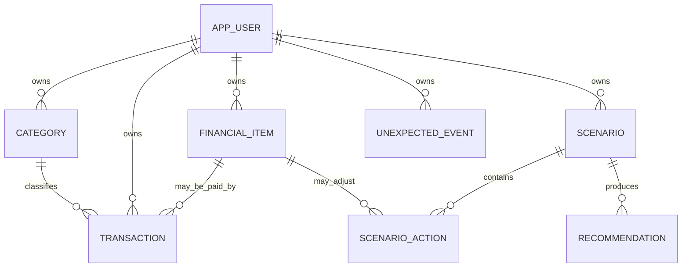

# Schéma de données — Budget

## Principes

- PostgreSQL managé (Neon recommandé), pas SQLite sur le système de fichiers éphémère de Vercel.
- Chaque ligne financière est rattachée à un propriétaire (`owner_id`); le serveur tire cet identifiant de la session authentifiée, jamais du corps HTTP.
- Les sommes sont des entiers en francs CFA XOF (`amount_xof`) pour le MVP; aucun calcul en virgule flottante.
- Les tables contiennent les faits enregistrés; les soldes et totaux sont calculés, pas saisis.
- Les identifiants sont des UUID. Les dates dues sont `DATE`; les instants de création sont `TIMESTAMPTZ`.

## Relations

## Tables MVP

### `app_user`

| Colonne | Type | Règle |
|---|---|---|
| `id` | `uuid` | Clé primaire; identifiant interne du propriétaire |
| `auth_subject` | `text` | Identifiant unique retourné par le mécanisme d’authentification |
| `currency_code` | `char(3)` | `XOF` pour le MVP |
| `timezone` | `text` | `Africa/Abidjan` (GMT/UTC+0) pour le MVP |
| `created_at` | `timestamptz` | Création UTC |

### `category`

| Colonne | Type | Règle |
|---|---|---|
| `id` | `uuid` | Clé primaire |
| `owner_id` | `uuid` | FK vers `app_user` |
| `name` | `text` | Non vide; unique par propriétaire sans tenir compte de la casse |
| `kind` | `text` | `income` ou `expense` |
| `is_default` | `boolean` | Distingue les catégories fournies des catégories personnalisées |
| `created_at` | `timestamptz` | Création UTC |

### `idempotency_record`

Cette table évite qu’une répétition réseau applique deux fois un scénario ou une création.

| Colonne | Type | Règle |
|---|---|---|
| `owner_id` | `uuid` | FK vers `app_user` |
| `idempotency_key` | `text` | Fourni pour une mutation rejouable; unique par propriétaire et opération |
| `operation` | `text` | Type stable de la mutation |
| `response` | `jsonb` | Résultat définitif renvoyé pour les répétitions de la même clé |
| `created_at` | `timestamptz` | Création UTC |

### `transaction`

| Colonne | Type | Règle |
|---|---|---|
| `id` | `uuid` | Clé primaire |
| `owner_id` | `uuid` | FK vers `app_user` |
| `category_id` | `uuid` | FK vers `category`; propriétaire et type doivent correspondre |
| `financial_item_id` | `uuid` | FK nullable vers `financial_item` pour relier un paiement |
| `kind` | `text` | `income` ou `expense` |
| `amount_xof` | `bigint` | Montant en francs CFA entiers, strictement supérieur à zéro |
| `currency_code` | `char(3)` | `XOF`, identique à la devise du profil |
| `occurred_on` | `date` | Date réelle du mouvement |
| `due_on` | `date` | Échéance facultative |
| `payee` | `text` | Bénéficiaire ou source facultative |
| `note` | `text` | Note facultative |
| `status` | `text` | `planned`, `paid` ou `deferred` |
| `created_at`, `updated_at` | `timestamptz` | Audit UTC |

### `financial_item`

Représente un engagement à suivre — dette, abonnement, projet ou poste personnalisé. Les paiements réellement effectués restent des transactions.

| Colonne | Type | Règle |
|---|---|---|
| `id` | `uuid` | Clé primaire |
| `owner_id` | `uuid` | FK vers `app_user` |
| `kind` | `text` | `debt`, `subscription`, `project` ou `custom` |
| `name` | `text` | Libellé non vide |
| `target_amount_xof` | `bigint` | Montant total connu; nullable si non applicable |
| `remaining_amount_xof` | `bigint` | Solde restant; surtout utilisé pour une dette |
| `planned_amount_xof` | `bigint` | Montant envisagé pour le mois |
| `due_on` | `date` | Prochaine échéance facultative |
| `cadence` | `text` | `once`, `weekly`, `monthly`, `yearly` ou `null` |
| `priority` | `smallint` | Échelle définie par le domaine; initialement 1–5 |
| `deferral_impact` | `text` | Conséquence attendue si l’action est reportée |
| `status` | `text` | `active`, `paused`, `completed` ou `cancelled` |
| `created_at`, `updated_at` | `timestamptz` | Audit UTC |

### `unexpected_event`

| Colonne | Type | Règle |
|---|---|---|
| `id` | `uuid` | Clé primaire |
| `owner_id` | `uuid` | FK vers `app_user` |
| `title` | `text` | Libellé non vide |
| `amount_xof` | `bigint` | Montant en francs CFA entiers, strictement positif |
| `occurred_on` | `date` | Date de l’imprévu |
| `due_on` | `date` | Date limite facultative |
| `urgency` | `smallint` | Échelle définie par le domaine; initialement 1–5 |
| `note` | `text` | Explication facultative |
| `status` | `text` | `open`, `planned`, `resolved` |
| `created_at` | `timestamptz` | Création UTC |

### `scenario`

| Colonne | Type | Règle |
|---|---|---|
| `id` | `uuid` | Clé primaire |
| `owner_id` | `uuid` | FK vers `app_user` |
| `name` | `text` | Libellé du scénario |
| `budget_month` | `date` | Premier jour du mois simulé |
| `event_id` | `uuid` | FK nullable vers l’imprévu à financer |
| `status` | `text` | `draft` ou `applied` |
| `created_at` | `timestamptz` | Création UTC |

### `scenario_action`

| Colonne | Type | Règle |
|---|---|---|
| `id` | `uuid` | Clé primaire |
| `scenario_id` | `uuid` | FK vers `scenario` |
| `financial_item_id` | `uuid` | FK nullable vers l’engagement affecté |
| `action` | `text` | `reduce`, `defer`, `pause` ou `allocate` |
| `amount_delta_xof` | `bigint` | Variation signée en francs CFA entiers |
| `consequence` | `text` | Conséquence lisible présentée à l’utilisateur |

### `recommendation`

| Colonne | Type | Règle |
|---|---|---|
| `id` | `uuid` | Clé primaire |
| `owner_id` | `uuid` | FK vers `app_user` |
| `scenario_id` | `uuid` | FK nullable vers `scenario` |
| `input_snapshot` | `jsonb` | Contexte minimal envoyé au moteur; exclure les champs inutiles |
| `result` | `jsonb` | Actions candidates ordonnées et explications validées |
| `provider` | `text` | `rules` ou `groq` |
| `model` | `text` | Identifiant du modèle si Groq a été appelé |
| `created_at` | `timestamptz` | Création UTC |

## Contraintes et index à créer

- FK de chaque enregistrement vers un propriétaire; suppressions en cascade uniquement après confirmation d’une suppression de compte.
- Vérifier que les catégories et engagements liés appartiennent au même propriétaire que la transaction.
- `CHECK (amount_xof > 0)` pour les montants d’entrée; empêcher les soldes de dette négatifs.
- Index `(owner_id, occurred_on DESC)` pour l’historique et `(owner_id, status, due_on)` pour les échéances.
- Index `(owner_id, kind, status)` sur les engagements et `(owner_id, budget_month)` sur les scénarios.
- Toute mutation multi-table et l’application d’un scénario s’effectuent dans une transaction SQL.
- Une contrainte unique garantit `(owner_id, operation, idempotency_key)` pour empêcher l’application en double lors d’une répétition réseau.
- Les mises à jour éditables portent une colonne entière `version`; l’API exige la version lue (`If-Match` ou champ de contrat) et retourne `409` si la version a changé.
- Ne jamais accepter ou persister un total calculé par le navigateur comme vérité.

## Décisions encore ouvertes

- Authentification et fournisseur de session; `auth_subject` est le point d’intégration abstrait.
- Gestion multi-devises et conversion; le MVP n'accepte que XOF.
- Le fuseau initial est fixé à `Africa/Abidjan` (GMT/UTC+0); support d'autres fuseaux hors MVP.
- Politique de conservation/suppression des recommandations contenant un snapshot.
- Date des transactions planifiées : confirmer si l’échéance distincte suffit ou s’il faut aussi une période budgétaire explicite.
